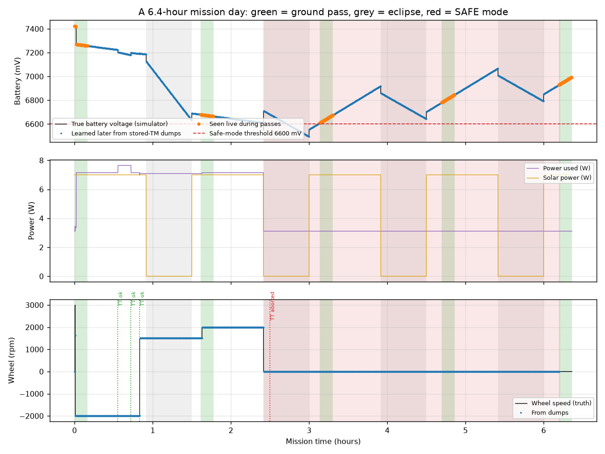

# MiniSat TM/TC: a CubeSat command & telemetry system, built from scratch

**Author:** Mohammed Yusuf · B.Tech ECE, NIT Puducherry
**What it is:** flight software for a small satellite's On-Board Computer (written in C), plus an
independent ground station (Python), plus a radio-link simulator that ties them together. You can
run a whole simulated mission day on a laptop and watch commands go up, telemetry come down,
bits get corrupted, and the satellite protect itself when its battery runs low.

Inspired by what I learned during my internship on a CubeSat OBC team. **It contains no
company or mission data**: every ID, number and format here is my own design, built on public
standards (CCSDS 133.0-B space packets, AX.25/HDLC framing, CRC-16/CCITT, CUC time codes).

---

## Results at a glance

| What was tested | Result |
|---|---|
| Unit tests (C) | 27 / 27 pass: CRC, big-endian codec, bit stuffing, packets, TLE checksums |
| Cross-language tests (Python vs C) | 7 / 7 pass: both sides agree byte-for-byte |
| Mission day (6.4 h, 5 ground passes, 35 commands) | Every bad command refused with the right reason; FDIR safe mode triggered and recovered correctly |
| Time-tagged commands run out of contact | 3 ran on time; 1 correctly **aborted** because the satellite was in SAFE mode by then |
| Telemetry seen live vs. recovered from on-board storage | only 13% live; the other 87% came back through stored-telemetry dumps |
| Noisy link, BER 1 in 1000 | 52% of commands confirmed first try, **97%** after automatic retries (theory: 54%) |
| CRC-16 strength (500,000 corrupted packets) | 1, 2, 3-bit errors and 16-bit bursts: **0 missed**. Heavy random damage: 4 in 200,000 missed (theory ≈ 1 in 65,536) |



---

## How it works (one picture)

```
 GROUND STATION (Python)                     RADIO LINK MODEL                  ON-BOARD COMPUTER (C)
 ───────────────────────                     ────────────────                  ─────────────────────
 operator plan  ─► build CCSDS TC  ─► HDLC  ─►  passes on/off   ─► bit-level  ─► CCSDS parse + CRC
 (scenarios.py)    (+ time tag)       frame     9600 bit/s           deframer     TC pipeline (7 gates)
                                       + FCS    random bit flips                  ├─ ACCEPTANCE ACK
 tables + plots ◄─ decode TM  ◄─ deframe ◄────  (BER)          ◄─ HDLC TX   ◄─   ├─ run now / schedule
 (run_all.py)      ACKs, HK, events, SSTM                         2 queues        ├─ EXECUTION ACK
                                                                                  physics: EPS, wheel, mag
                                                                                  FDIR, SSTM, storage, dump
```

The two programs run in **lock-step** (software-in-the-loop): every 100 ms of simulated time the
ground sends the uplink bits for that slice, the flight software runs its 10 ms ticks, and sends
back the downlink bits it produced.

---

## Folder map

| Folder | What's inside |
|---|---|
| `flight_sw/include/icd.h` | **The ICD as code**: every APID, command ID and error code. The ground station reads this same file, so the two sides can't drift apart. |
| `flight_sw/src/codec.c` | CRC-16/CCITT-FALSE and a bounds-checked big-endian reader/writer |
| `flight_sw/src/hdlc.c` | AX.25/HDLC framing with real bit stuffing, and a bit-level flag-hunting receiver |
| `flight_sw/src/ccsds.c` | CCSDS space packets: build/parse, CUC time, length-minus-one, packet CRC |
| `flight_sw/src/obc.c` | The OBC application: TC validation pipeline, two-stage ACKs, time-tag scheduler, FDIR safe mode, SSTM, on-board storage + paced dump, rate-limited transmitter, simulated EPS/ADCS/COMMS |
| `flight_sw/src/obc_sim_main.c` | Runs the flight software on a PC for the simulation |
| `flight_sw/tests/test_main.c` | C unit tests |
| `ground/` | Independent Python implementation: `link.py` (framing/packets), `station.py` (ground station + channel model), `test_ground.py` |
| `sim/` | `scenarios.py` (mission day, BER sweep), `run_all.py` (runs everything, makes plots) |
| `results/` | Plots, CSV logs (every command, every telemetry packet, truth data), `summary.json` |
| `docs/` | `MiniSat_Project_Report.pdf` (full explanation in plain language), `ICD.md` (packet formats) |

---

## Run it yourself

Needs a C compiler and Python 3 with `numpy` and `matplotlib`.

```bash
cd flight_sw
./build.sh                # or: make        (any C99 compiler; CC="zig cc" works too)
./build/unit_tests        # 27 passed, 0 failed
cd ..
python3 ground/test_ground.py   # 7 passed, 0 failed
python3 sim/run_all.py          # ~20 s: regenerates everything in results/
```

---

## Design decisions worth talking about

1. **One source of truth.** `icd.h` is parsed by the Python ground station at start-up. Changing a
   number in one place changes it everywhere.
2. **Two independent implementations.** The ground's framing and packet code is written separately
   in Python. If both agree end-to-end, the format is unambiguous.
3. **Check everything before anything moves.** Seven gates (CRC, APID, duplicate, known command +
   length, mode, parameter range, time tag + schedule space) before the acceptance ACK.
4. **Two ACKs.** Acceptance ("I got it and it's valid") and execution ("it's done"). Time-tagged
   commands get their execution ACK hours later, so it's also **stored on board** and comes down
   with the next dump.
5. **Re-check at execution time.** A time-tagged command accepted while healthy is aborted if the
   satellite is in SAFE mode when its time arrives.
6. **Safe retries.** Ground retries with the *same* sequence count. If the first copy did arrive
   and only its ACK was lost, the satellite answers DUPLICATE, and the ground knows it's done.
7. **No undefined behaviour.** Bounds-checked cursor (no buffer overruns), no `memcpy(NULL, 0)`,
   rates validated so nothing divides by zero, interrupt-style work kept tiny.
